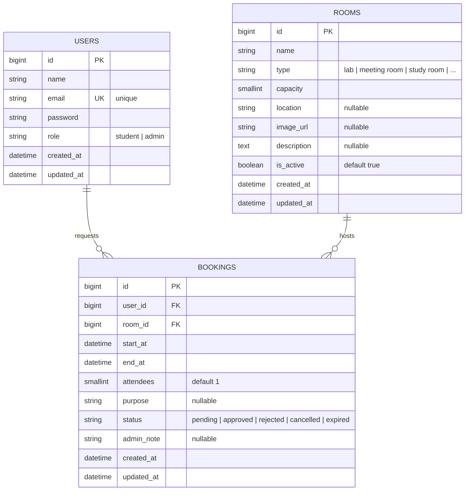

# Roomly

**Room booking for study and meeting rooms — a Laravel REST API paired with a Flutter Material 3 client and a small web panel where admins review requests.**

Instead of asking "is CL02 free right now?", students browse the rooms, read the day's timeline and request a slot. An admin approves or rejects the request in the web panel, and a booking nobody reviewed before its start time expires on its own. Every duplicate-slot protection lives in one service class so the mobile app and the web panel enforce identical rules.

Group project for the Mobile Application Development module at the National University of Management.

## Group members

| Name |
| --- |
| Srun Sochettra |
| Tep Makara |
| Ty Vichheka |
| Yorn Yain |

## Repository map

| Folder | What lives here |
| --- | --- |
| [`backend/`](backend/) | Laravel 13 REST API — Sanctum token auth, PostgreSQL, booking rules, Blade admin panel |
| [`mobile/`](mobile/) | Flutter app for students — rooms grid, day timeline, booking sheet, my bookings, profile |
| [`postman/`](postman/) | Ready-to-import Postman collection covering every endpoint |

## Database diagram

Three business tables; Sanctum adds `personal_access_tokens`, Laravel adds cache and job tables.



### Booking rules

All rules sit in [`backend/app/Services/BookingService.php`](backend/app/Services/BookingService.php):

- **Overlap check** — two ranges collide when one starts before the other ends and ends after the other starts. Back-to-back bookings (09:00–10:00 then 10:00–11:00) are fine.
- **Race protection** — the room row is locked `FOR UPDATE` inside the transaction, so two simultaneous requests cannot both pass the overlap check.
- **Lifecycle** — `pending` → `approved` / `rejected` / `cancelled` by an admin, or automatically `expired` when nobody reviewed a pending request before `start_at`. Expired runs every minute via the scheduler and again before bookings are listed, so the demo stays correct even without a running scheduler.
- **Cancellation limits** — a booking can be cancelled only while it is still `pending` or `approved` and before it has started.

## API the mobile app talks to

Token auth via Laravel Sanctum. Register and login are public; everything else needs a Bearer token. Login is throttled to 10 attempts per minute.

| Method | Endpoint | Who | Behaviour |
| --- | --- | --- | --- |
| POST | `/api/register` | anyone | Creates a `student` account, returns the user and token |
| POST | `/api/login` | anyone | Same payload, throttled |
| GET | `/api/me` | signed in | Current user |
| POST | `/api/logout` | signed in | Revokes the current token |
| GET | `/api/rooms` | signed in | Room list, each with today's booking summary |
| GET | `/api/rooms/{room}` | signed in | One room with its own schedule |
| GET | `/api/rooms/{room}/schedule` | signed in | Bookings for a chosen date |
| GET | `/api/bookings` | signed in | The current user's bookings (optionally `?tab=`) |
| POST | `/api/bookings` | signed in | Creates a `pending` booking after the overlap check |
| PATCH | `/api/bookings/{booking}/cancel` | owner | Cancels while still allowed |
| GET /api/me... | admin-only routes | admin | Room create/update/delete and booking status changes, listed in [`backend/routes/api.php`](backend/routes/api.php) |

`/admin` is a server-rendered Blade panel for the same data: login, dashboard, booking review (approve / reject / cancel) and room management. Students who try to sign in on the mobile app with an admin account are pointed back to the web panel.

## Run locally

Two apps, two terminals.

### Backend

Requires PHP 8.3+, Composer and a PostgreSQL server.

```sh
cd backend
composer install
cp .env.example .env            # then set DB_* credentials in .env
php artisan key:generate
php artisan migrate
php artisan serve               # http://127.0.0.1:8000
```

Create an admin account from the project root (passwords are hashed automatically by the model cast):

```sh
php artisan tinker --execute="App\Models\User::create(['name' => 'Admin', 'email' => 'admin@example.com', 'password' => 'admin-password', 'role' => 'admin']);"
```

To also run the expiry scheduler in a second terminal:

```sh
php artisan schedule:work
```

### Mobile app

```sh
cd mobile
flutter pub get
flutter run
```

[`mobile/lib/config.dart`](mobile/lib/config.dart) selects the API host: the Android emulator reaches the laptop at `http://10.0.2.2:8000/api`, a real phone needs the laptop's LAN IP plus `php artisan serve --host=0.0.0.0`, and both can be overridden at launch:

```sh
flutter run --dart-define=API_URL=http://192.168.1.20:8000/api
```

Import [`postman/Roomly.postman_collection.json`](postman/Roomly.postman_collection.json) into Postman to exercise the API from the desktop side.

## Checks

```sh
# Backend
cd backend && php artisan test        # BookingRulesTest covers the overlap and lifecycle rules

# Mobile
cd mobile && flutter analyze
cd mobile && flutter test
```

## Screenshots

The repository does not ship screenshots yet; capture the set below into `docs/screenshots/` (exact filenames were chosen so the images can simply be dropped in).

| File | Captures |
| --- | --- |
| `login.png` | Login screen of the mobile app |
| `rooms.png` | Rooms tab with the room grid |
| `room-detail.png` | Room detail with the day timeline |
| `booking-sheet.png` | Booking sheet mid-form |
| `my-bookings.png` | My bookings tab |
| `profile.png` | Profile tab with theme switch |
| `postman-rooms.png` | Postman: `GET /api/rooms` response |
| `postman-booking.png` | Postman: `POST /api/bookings` response |
| `postman-conflict.png` | Postman: 422 conflict response |
| `admin-panel.png` | Admin web panel booking review |

Once the captures exist, add a gallery section (the same two-column table style used in
[`flutter-meal-student`](https://github.com/SRUN-Sochettra/flutter-meal-student)).

## Notes and limitations

- Everything runs on plain HTTP on loopback or the LAN. Pointing the app at a public host would need TLS and a real secret policy; see [SECURITY.md](SECURITY.md).
- Sanctum tokens have no expiry date configured. Revocation happens through logout or `php artisan sanctum:prune-expired` (not wired by default).
- Registration always creates `student` accounts; admins are created through tinker or the database, never through the API.
- No seed data for rooms is supplied — create rooms through the admin panel while the database is fresh.
- The mobile client keeps its session token in `SharedPreferences` and keeps it when the device is offline, so a launch without a network still resumes the last session when the API is reachable.
- [`repomix-output.xml`](repomix-output.xml) is an agent-generated bundle of the source tree; it reflects the moment it was created, not the live files.
